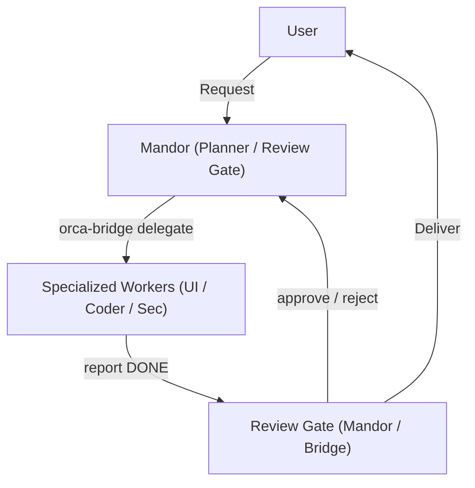

# mandordantukangv3

Multi-agent squad orchestration system for AI coding workflows in Orca IDE.

A planner and review gate agent (Mandor) coordinates specialized hands-on worker agents (Tukang UI, Coder, and Security) across dedicated terminal panes using `orca-bridge`. Workers operate under strict allowlists and single-command verifications to eliminate handoff context leaks.



## Requirements

- Orca IDE with `orca` CLI installed
- Bash (version 4 or later)
- Node.js (version 16 or later)
- Agent CLIs (e.g. OMP, Claude Code, Antigravity / Gemini)

## Installation

Clone the repository to the skill directory and run the installer:

```bash
git clone https://github.com/annnpiwww/mandordantukangv3 ~/.agents/skills/mandordantukangv3
bash ~/.agents/skills/mandordantukangv3/scripts/install.sh --global-rules
```

Installer options:
- `--global-rules`: installs global agent rule blocks and skill links.
- `--force`: overwrites existing skill files with backups preserved.
- `--uninstall`: removes installed binaries, shared libraries, and global rule blocks.

## Squad Launcher

Launch the 2x2 multi-agent terminal grid in Orca IDE for the target project:

```bash
orca-squad [project_dir]
```

Panes configured:
- Pane 1: Mandor (Frontier model, e.g. Claude Opus / Sonnet / GPT) - Planning and Review Gate
- Pane 2: Tukang UI (Fast model, e.g. Gemini Flash) - UI/UX and Visual QA
- Pane 3: Tukang Coder (Fast model, e.g. Gemini Flash) - Core Logic and Data
- Pane 4: Tukang Security (Deep-reasoning model, e.g. Gemini Argon) - OWASP Security Core and Tests

## User Profile

Personal communication preferences, shell command prefixes, and project release steps are configured in `profile.local.md` in your skill directory. Copy the provided template to get started:

```bash
cp profile.example.md profile.local.md
```

`profile.local.md` is gitignored so individual preferences do not leak into shared repositories.

## orca-bridge Command Reference

Derived from `scripts/orca-bridge.sh` usage definitions:

```bash
# Core inter-agent relay
orca-bridge send <pane> <message>
orca-bridge read <pane> [lines]
orca-bridge wait <pane> [timeout_ms]

# Delegation and task reports
orca-bridge delegate [--to <worker>] --spec <spec.json|->
orca-bridge delegate [--to <worker>] [--force] <task_title> <instructions>
orca-bridge report <DONE|PLAN|QUESTION|NEEDS_REVISION|BLOCKED> [--task <id>] <summary...>

# Task lifecycle management
orca-bridge task <new|assign|check|approve|reject|resume|revert|amend|fail|discard|diff|status|list|log>

# Token usage tracking
orca-bridge usage <add <id> --role R --in N --out N --source actual|estimated [--model M --cost USD --calls N]|collect <id>|report [id] [--csv]|compare>

# Terminal pair bindings
orca-bridge pair <bind <mandor|tukang|ui|coder|sec> <handle>|show|clear>

# Verification and browser automation
orca-bridge detect-verify [dir]
orca-bridge browser <snapshot|screenshot <path>|errors|network|goto <url>>

# Workspace and monitoring
orca-bridge worktree <list|create <name>|current>
orca-bridge monitor <check|watch <task_id>>

# Squad status and version
orca-bridge status
orca-bridge version

# Memory and accountability
orca-bridge lesson <add <role|all> <text>|list [role]>
orca-bridge complaint <add <topic> <text>|list>
orca-bridge scorecard [days]
```
