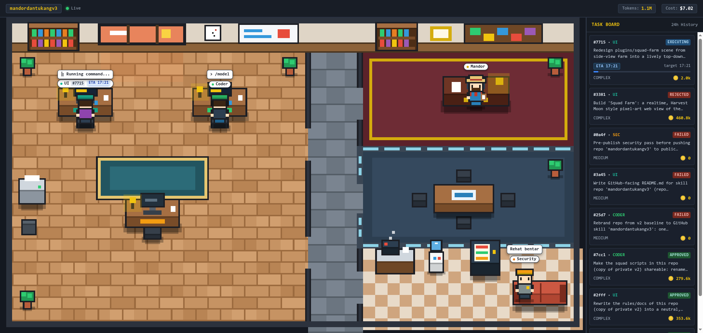
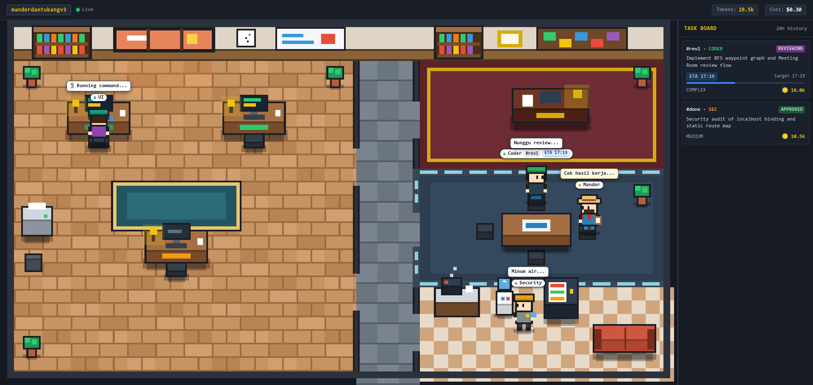
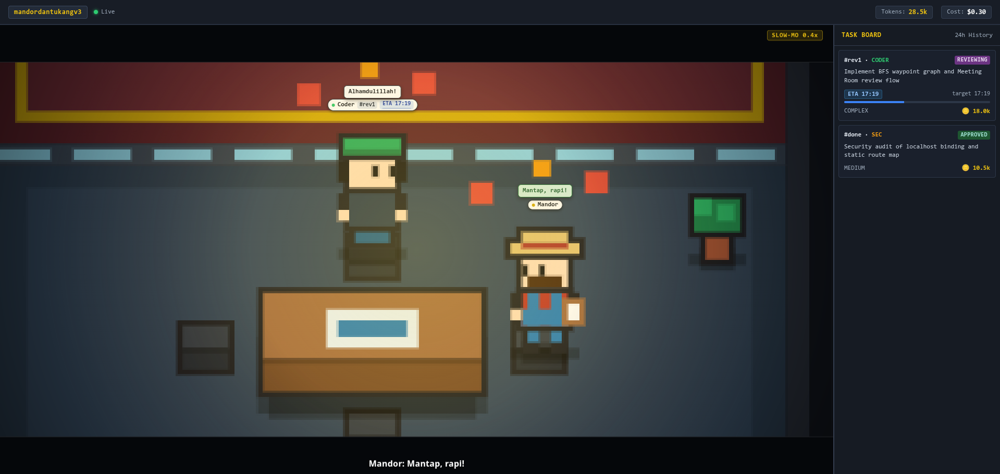

# Squad Farm (Pixel Office Edition)

Realtime top-down (3/4 view) pixel-art office web view of the Orca multi-agent squad (1 Mandor + 3 specialized workers: UI, Coder, Security), complete with waypoint room navigation, ETA tracking, and ZackD Films style cinematic gate cutscenes.







`orca-squad [project_dir]` starts it automatically and opens it in Orca's embedded browser (can also be started manually with `plugins/squad-farm/launch.sh <project_dir>`). Manual run:
```bash
node plugins/squad-farm/server.js --port 24300 --repo /path/to/project
```
Then open `http://127.0.0.1:24300` in Orca's embedded browser.

## Features

- **Top-Down 3/4 Pixel Office (`384x216`, 16px tiles)**:
  - **Work Area**: Warm wood floor, center rug, printer, plants, and 3 dedicated desks (UI, Coder, Security) with flickering monitors, desk lamps, mugs, and nameplates.
  - **Mandor Office**: Executive carpet room with master task board and desk.
  - **Meeting Room**: Glass-walled partition with round table and 4 chairs where workers wait during `VERIFYING` and `REVIEWING`.
  - **Pantry / Lounge**: Checkered tile floor with steaming coffee machine, water cooler, lit vending machine, and 2-seat sofa.
- **Waypoint Navigation (`behavior.js`)**:
  - Characters walk along a doorway/hallway waypoint graph via BFS pathfinding (`32 px/s`) without clipping through walls.
  - Working characters type at their desk; reviewing characters walk to the Meeting Room; idle characters rotate deterministically between coffee, water cooler, vending machine, and sofa (falling asleep with `Zzz` after 5 minutes).
- **ZackD Films Style Cinematic Cutscenes**:
  - On queued gate events (`DONE` walk to meeting room, `APPROVED` praise, `REJECTED` anger, `STALL`), the camera eases (`cubic`) to a `2.65x` zoom centered on the acting characters with `12%` top/bottom letterbox bars, radial vignette, `16px` bold subtitle, and a `300ms` `0.4x` slow-mo window at peak reaction.
  - Respects `prefers-reduced-motion` (disables zoom, shake, and slow-mo while preserving letterbox fade and subtitles).
- **Task ETA Tracking (`eta: <N>m`)**:
  - Parses the latest `report PLAN: ... eta: <N>m` entry from `events.log` into `task.eta_at`.
  - Shows `ETA HH:MM` with a thin progress bar in worker task chips and Task Board rows; turns amber (`telat <M>m`) and triggers Mandor's impatient bubble (`Katanya jam HH:MM?`) when overdue.

## CLI Options

| Flag | Default | Description |
|---|---|---|
| `--port` | `24300` | Port to bind (`127.0.0.1` only) |
| `--repo` | Current working directory | Path to target project repository |

## Environment Variables

| Variable | Description |
|---|---|
| `MANDOR_STATE_DIR` | Overrides the default state root directory (`~/.local/state/mandordantukangv3` or `~/.local/state/mandordantukang`) |

## Snapshot Schema

GET `/snapshot.json` and SSE stream on `/events` emit snapshot JSON objects:

```json
{
  "ts": 1793953996940,
  "repo": "mandordantukangv3",
  "workers": [
    {
      "role": "ui",
      "handle": "term_4fe79738-40e3-4745-9415-eeaa81aa4325",
      "online": true,
      "activity": "working",
      "doing": "Editing style.css...",
      "task_id": "t20261106-164908-7715"
    },
    {
      "role": "coder",
      "handle": "term_0f715ba8-c2b2-4116-8cfe-fea2255ffb45",
      "online": true,
      "activity": "idle",
      "doing": "idle",
      "task_id": null
    },
    {
      "role": "sec",
      "handle": "term_71c6ec73-e226-40d4-b87d-9f795b3bc972",
      "online": true,
      "activity": "idle",
      "doing": "idle",
      "task_id": null
    }
  ],
  "mandor": {
    "handle": "term_8cb7525e-df42-496a-aca6-9cf968af2ae9",
    "mood": "calm"
  },
  "tasks": [
    {
      "id": "t20261106-164908-7715",
      "worker": "ui",
      "type": "COMPLEX",
      "objective": "Redesign plugins/squad-farm scene into a top-down pixel-art office...",
      "state": "EXECUTING",
      "retries": 0,
      "updated_at": 1793953716000,
      "plan_at": 1793953116000,
      "eta_at": 1793954616000,
      "tokens": {
        "tukang": 2619,
        "mandor": 0,
        "cost_usd": null,
        "source": "estimated"
      },
      "last_event": "report PLAN: ... | eta: 25m",
      "verify_exit": null,
      "alert": "OK"
    }
  ],
  "totals": {
    "tokens": 650871,
    "cost_usd": 5.89
  }
}
```

## Demo Video

Play the scripted squad demo story directly in Orca or any browser:
```
http://127.0.0.1:24300/?cutscene=demo
```

Record the demo cutscene to H.264 MP4 (16:9 and 9:16 vertical):
```bash
node plugins/squad-farm/record-demo.mjs --vertical [--url http://127.0.0.1:24300/] [--out ~/Videos/squad-farm-demo.mp4]
```

Add tempo-synced sound effects and 8-bit BGM (stream copy, no re-encoding):
```bash
node plugins/squad-farm/add-sfx.mjs --video ~/Videos/squad-farm-demo.mp4 [--out ~/Videos/squad-farm-demo-sfx.mp4]
```

## Limitations

- **Token Counts**: Exist only where the bridge recorded usage metrics in `usage.jsonl`.
- **Activity Heuristics**: Inferred from terminal text and spinner glyphs in active pane stdout.
- **Read-Only**: Serves as an observability dashboard; does not control or mutate task execution.
